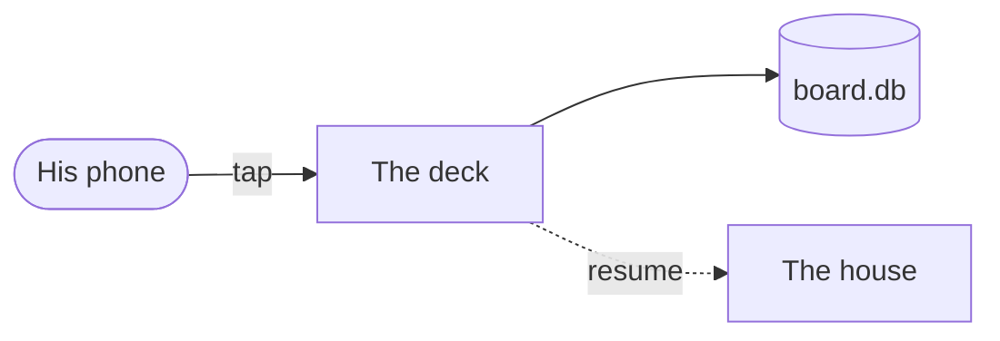

# c-900 Answers live on the card

He is deciding where plan answers are stored and whether the deck sends them in one tap. Two decisions, one risk worth reading.

## Goal

Every answer he taps reaches the house on resume, with no poll (see `keel/prompts.py:12`).

## Now

A plan's answers live in lavish's own state file and are read back by a bounded poll.

## Target

```compare Today against the target
left: Today
right: After
Where an answer lands | lavish's state file | an event on the card
How the house gets it | `lavish-axi poll` on resume | quoted in the resume prompt
```

## Proposal

The deck renders the plan and records each tap as a `mark` event on c-900.



```board The round, as the house pushed it
b-1
```

```python keel/planstate.py:40-52 | where the prompt is composed
def compose(marks):
    return "\n".join(marks)
```

Rows say which file changes and why:

| File | Change | State |
|---|---|---|
| `keel/planformat.py` | the parser | [ok] done |
| `app/ui.plan.js` | the page | [warn] in progress |

> [!settled] Decided in discussion
> The store is the board, as Q4 said.

## Decisions

```decision store
q: Where do his answers live?
why: One store is a hard rule (CLAUDE.md).
option card: As events on the card
  gets: one store, the stream tells the page
  cost: a new event kind
option file: In a file beside the plan
  gets: nothing new in the schema
  cost: a second store that must agree with the board
rec: card
because: the board is the only state
```

```batch triage
q: What to do with each finding
choices: fix, defer, drop
f1: The cap is off by one | fix | a real bug
f2: A comment is stale | drop
```

## Risks

- **Risk:** an old deck reads an unknown event kind. **Mitigation:** the kind is added in one place.

## Steps

```steps
[done] Parser | markdown plus the fenced blocks
[doing] Renderer
Lint
```

## Proof

- [x] `make test` green
- [ ] a render at 390x844

## Out of scope

- Slides.

## Open questions

- Should Approve fill every unanswered decision? Recommend: yes, and say so on the card.
- Does the outcome use the same page?
